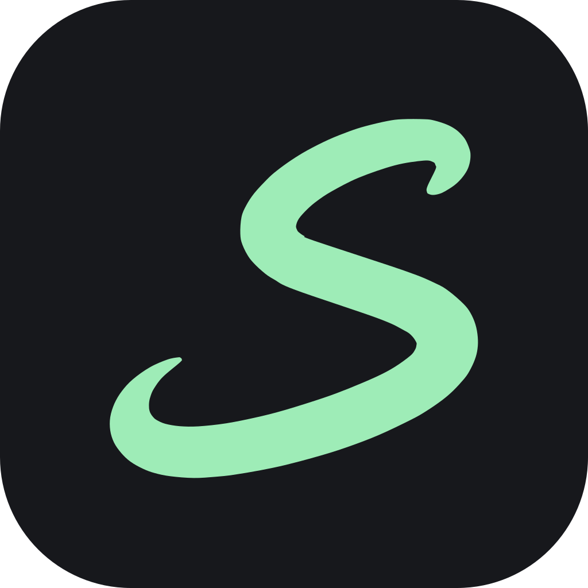
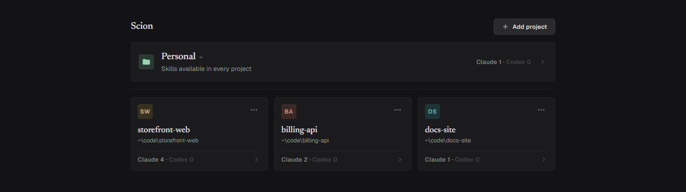
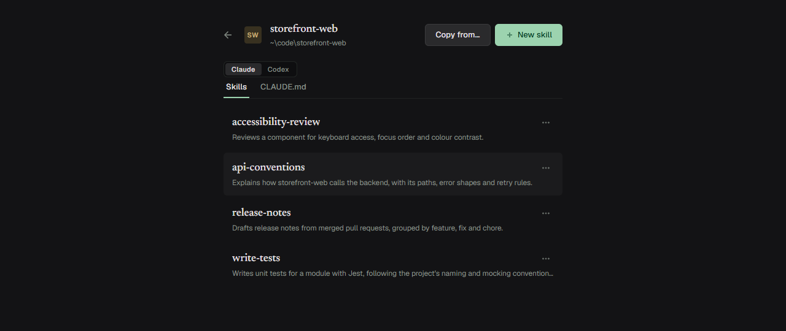
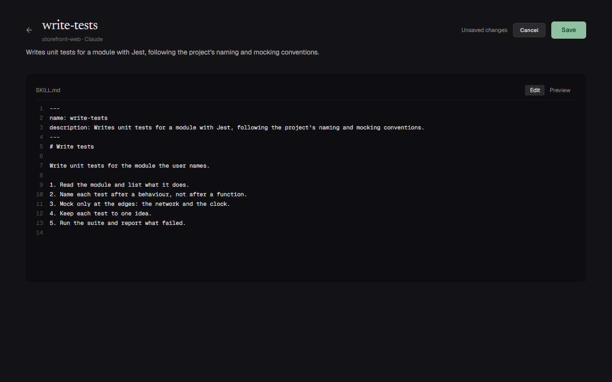
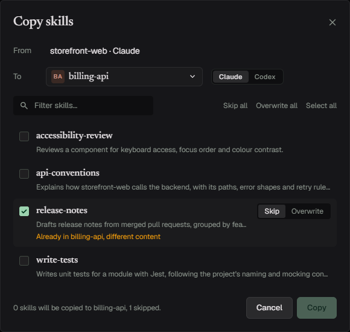
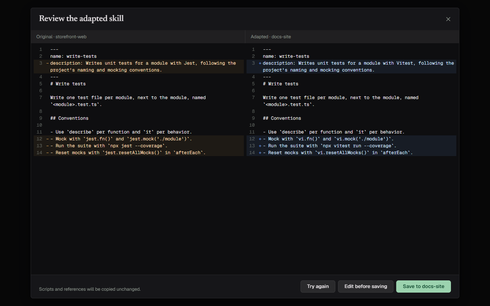
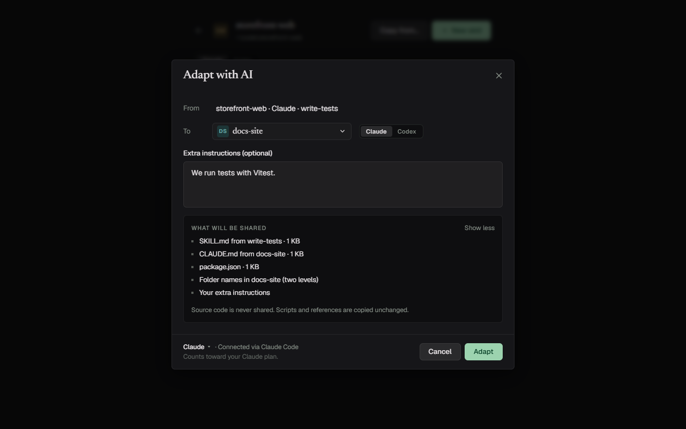

<div align="center">



# Scion

**Manage AI agent skills per project, and adapt them instead of just copying.**

[leventozz.github.io/scion](https://leventozz.github.io/scion)

[](https://github.com/leventozz/scion/actions/workflows/ci.yml)
[](LICENSE)
[](https://dotnet.microsoft.com/download)
[](#status)

<br>



</div>

## Why Scion

Skills for coding agents (Claude Code, Codex) live in folders next to your code, one set per project.
Keeping them in step by hand means digging through hidden folders and copying files that were written
for a different stack.

Scion is **project-centric**: there is no central skill library. You add your projects one by one, open
one, and see its skills and its agent instruction file (`CLAUDE.md` / `AGENTS.md`). When a skill is
useful somewhere else, Scion can **adapt** it to the target project's stack and conventions rather than
copy it as it is.

## Features

### Browse

- A grid of your projects, most recently opened first, with your **Personal** skills pinned on top.
- Per project: a Skills tab and an instruction-file tab, for Claude Code and for Codex.
- A skill page with its file tree and the rendered `SKILL.md`.
- Skills that break the [Agent Skills specification](https://agentskills.io/specification) are still
  listed, with a warning, never hidden.

<div align="center">

</div>

### Edit and create

- Edit `SKILL.md`, any text file of a skill, and `CLAUDE.md` / `AGENTS.md` in place, with a Markdown
  preview. The skill's description and warnings follow your draft as you type.
- If a file changed on disk since you opened it, Scion asks before it saves (Cancel, Reload or Overwrite).
- Create a skill from a template, or create the instruction file a project doesn't have yet.

<div align="center">

</div>

### Copy

- Copy a skill to another project, to Personal, or to another agent. A skill is always copied as a whole
  folder, including `scripts/`, `references/` and `assets/`.
- When the target already has a skill with that name, you choose Skip or Overwrite for it.

<div align="center">

</div>

### Adapt with AI

- Pick a skill, a target project and an agent, and let Claude Code or Codex adapt it to the target's
  stack and conventions. Add instructions of your own if you want.
- Review the result side by side with the original, edit it if you like, and save only when you are happy.
  Nothing is written before that.
- Scion runs your own installed and signed-in client, as a subprocess. It has no API keys and no accounts
  of its own.

<div align="center">

</div>

### Safe by default

- Scion never writes its own files into your repositories. Its metadata (registered projects, backups,
  trash) lives in `~/.scion/`.
- "Remove from Scion" only unregisters a project. It never deletes a folder.
- "Delete" moves a skill to Scion's own trash. It is never deleted for good.
- Nothing existing is overwritten without an explicit decision. An overwrite is built in a scratch folder
  first and the old version is restored if it fails.
- Every save keeps the previous version of the file (the last 20 per file).
- Scion looks for updates in the releases of its GitHub repository (`leventozz/scion`): when you choose
  *Check for updates* (click *Scion* at the top left), and when it starts, at most once a day. It sends only the
  request for the list of releases and, when you choose *Download update*, the download of the package. It sends
  no credentials and nothing about your projects or skills. Switch the check at start-up off with
  *Check for updates when Scion starts* in the same place.

## Getting started

Requirements:

- [.NET 10 SDK](https://dotnet.microsoft.com/download) (see `global.json`).
- Optional, for *Adapt with AI*: your own installed and signed-in
  [Claude Code](https://www.anthropic.com/claude-code) or Codex CLI.
- Linux additionally needs WebKitGTK at runtime.

```
git clone https://github.com/leventozz/scion.git
cd scion
dotnet run --project src/Scion.Host.Desktop
```

Then choose **Add project** and pick a folder. Projects are added one by one; Scion does not scan your disk.

Where each agent keeps its files, and where Scion looks:

| | Claude Code | Codex |
|---|---|---|
| Personal skills | `~/.claude/skills/` | `~/.agents/skills/` |
| Project skills | `<project>/.claude/skills/` | `<project>/.agents/skills/` |
| Project instruction file | `<project>/CLAUDE.md` or `<project>/.claude/CLAUDE.md` | `<project>/AGENTS.md` |
| Personal instruction file | `~/.claude/CLAUDE.md` | `~/.codex/AGENTS.md` |

## What Adapt with AI sends

An adaptation shares only an allowlist of the target:

- the agent's instruction files,
- project manifests (`*.csproj`, `*.sln`, `*.slnx`, `package.json`, `pyproject.toml`, `go.mod`, `Cargo.toml`,
  `pom.xml`, `build.gradle`),
- folder names, two levels deep.

Never a source file. Each file is capped at 32 KB and the whole request at 128 KB; a file is never cut,
and what is left out is listed as "Not shared". A Personal target shares only its personal instruction file.

The dialog lists exactly what will be sent **before** you press *Adapt*, and nothing is written until you
save the reviewed result. Scion never reads, stores or transmits AI credentials; the sign-in belongs to
the client you installed.

<div align="center">

</div>

One more thing goes with a request that Scion does not control: a file that the client loads by itself.
When there is one (for Codex, its personal instruction file), the dialog lists it last, marked as loaded by
that client, so you know what else goes with the request. Scion never reads its content.

## Development

```
dotnet build
dotnet test
```

The smoke tests drive the real desktop app and run on Windows only; a plain `dotnet test` skips them:

```
dotnet test tests/Scion.Smoke.Tests --filter Category=Smoke
```

The screenshots of the README and the website that need a real app (`docs/images/skill-edit.png`, `copy-conflict.png`) are
made by `dotnet test tests/Scion.Smoke.Tests --filter Category=DocsImages` (Windows only; run on request, never by `dotnet test`).

The `SCION_*` environment variables read by `src/Scion.Host.Desktop/Program.cs` (`SCION_HOME`,
`SCION_TEST_FOLDER`, `SCION_TEST_SHELL_LOG`, `SCION_CLAUDE_PATH`, `SCION_CODEX_PATH`) exist for the
automated tests. The automated tests never call a real Claude or Codex; they use stand-in executables.

### Architecture

Clean Architecture; source-code dependencies point only inward:

```
Domain  <-  Application  <-  Infrastructure / UI  <-  Host
```

| Project | Role |
|---|---|
| `Scion.Domain` | entities, value objects, rules; depends on nothing |
| `Scion.Application` | use cases, ports (interfaces) and DTOs |
| `Scion.Infrastructure.*` | file system, project registry, and the Claude Code and Codex adapters |
| `Scion.UI` | Blazor components in a Razor Class Library; knows only Application |
| `Scion.Host.Desktop` | PhotinoX window and dependency wiring (composition root) |

The Dependency Rule is enforced by `tests/Scion.Architecture.Tests`, which runs with every `dotnet test`.
A new AI provider or agent is a new adapter class and a registration, not a change to existing code.

## Status

Pre-1.0. Developed and tested on Windows.

Planned:

- Verify macOS and Linux (the code targets them, but they have not been run yet).
- A first release with a Windows build, so you can download the app instead of building it.
- Codex: honour `CODEX_HOME`, and warn on the instruction-file tab when an `AGENTS.override.md` makes
  the `AGENTS.md` beside it have no effect.

Not in scope for v1: adapting several skills at once, adapting scripts, `CLAUDE.local.md`, instruction
files in subfolders, and symlinked skill folders.

## Trademarks

Claude and Anthropic are trademarks of Anthropic, PBC. Codex, ChatGPT and OpenAI are trademarks of
OpenAI. Scion is not affiliated with either company.

## License

MIT, see [LICENSE](LICENSE). Third-party components: [THIRD-PARTY-NOTICES.md](THIRD-PARTY-NOTICES.md).
